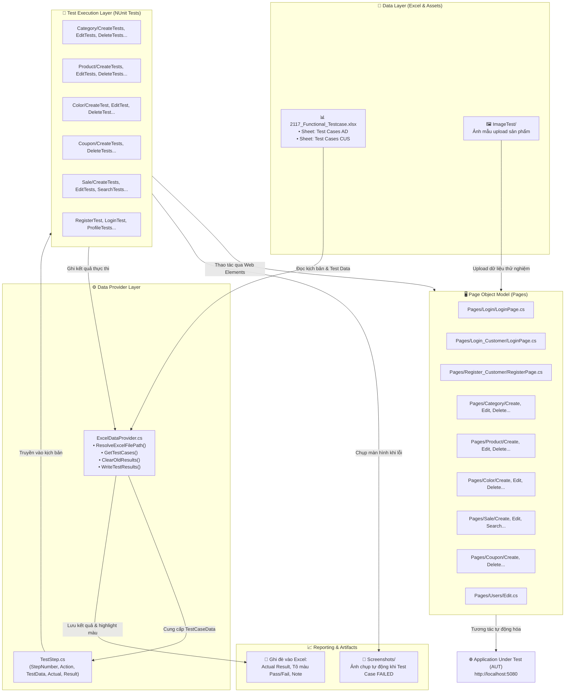

# 📱 PhoneStore Automation Testing & Quality Assurance Suite
### Giải Pháp Kiểm Thử Tự Động & Thủ Công Toàn Diện Cho Hệ Thống Website Thương Mại Điện Tử Bán Điện Thoại

[](https://dotnet.microsoft.com/)
[](https://learn.microsoft.com/dotnet/csharp/)
[](https://www.selenium.dev/)
[](https://nunit.org/)
[](https://epplussoftware.com/)
[](#-kết-quả-kiểm-thử-test-results--summary)
[](#-kết-quả-kiểm-thử-test-results--summary)

---

## 🎯 GIỚI THIỆU TỔNG QUAN DỰ ÁN

Dự án cung cấp bộ giải pháp kiểm thử chất lượng phần mềm toàn diện (Software Quality Assurance & Automated Testing) cho hệ thống website thương mại điện tử **Quản Lý Bán Điện Thoại (PhoneStore)**. Hệ thống bao gồm hai phân hệ riêng biệt với các luồng nghiệp vụ tương tác phức tạp:

1. **Phân hệ Quản trị (Admin / Quản lý cửa hàng):** Vận hành toàn bộ hệ thống bán hàng bao gồm đăng nhập xác thực, dashboard thống kê doanh thu, quản lý danh mục (Category), quản lý màu sắc (Color), quản lý sản phẩm (Product), chương trình khuyến mãi (Sale), mã giảm giá (Coupon), xử lý vòng đời đơn hàng (Order) và quản lý người dùng / phân quyền (RBAC).
2. **Phân hệ Khách hàng (Customer / Người mua sắm):** Trải nghiệm mua sắm trực tuyến từ đăng ký tài khoản, đăng nhập, quản lý thông tin hồ sơ cá nhân, tìm kiếm và lọc sản phẩm, quản lý giỏ hàng, áp dụng coupon giảm giá và đặt hàng thanh toán (COD / Thẻ tín dụng).

### Các mục tiêu kỹ thuật cốt lõi:
- **Chuẩn hóa tài liệu kiểm thử:** Xây dựng danh mục yêu cầu kiểm thử (**Test Requirements**) và bộ trường hợp kiểm thử (**Test Cases**) theo phương pháp kiểm thử hộp đen (Equivalence Partitioning, Boundary Value Analysis, Decision Table, Use Case Testing).
- **Tự động hóa kiểm thử (Automation Testing):** Xây dựng framework kiểm thử tự động mạnh mẽ trên nền tảng **C# / .NET 10** kết hợp **Selenium WebDriver**, **NUnit**, áp dụng mô hình thiết kế **Page Object Model (POM)** và phương pháp **Data-Driven Testing (DDT)**.
- **Tương tác dữ liệu hai chiều với Excel:** Nạp kịch bản kiểm thử động từ file `2117_Functional_Testcase.xlsx` bằng thư viện **EPPlus**, thực thi từng bước kịch bản trên trình duyệt và **tự động ghi đè kết quả thực tế (Actual Result), trạng thái Pass/Fail (highlight màu sắc trực quan) kèm đường dẫn ảnh chụp màn hình lỗi (Failure Screenshot)** vào chính file Excel.
- **Phát hiện và truy vết khiếm khuyết (Bug Detection):** Nhận diện các lỗi tiềm ẩn về validation dữ liệu nhập liệu, tính toàn vẹn nghiệp vụ, cơ chế trừ/hoàn tồn kho tự động và tính đồng bộ giữa hai phân hệ Admin và Customer.

---

## 🛠 CÔNG NGHỆ & CÔNG CỤ SỬ DỤNG

| Hạng mục | Công nghệ / Thư viện | Phiên bản | Mục đích sử dụng |
| :--- | :--- | :---: | :--- |
| **Nền tảng thực thi** | [.NET SDK](https://dotnet.microsoft.com/) | `10.0` / `9.0` | Nền tảng biên dịch và thực thi test suite |
| **Ngôn ngữ lập trình** | [C#](https://learn.microsoft.com/dotnet/csharp/) | `Latest` (12/13) | Ngôn ngữ phát triển toàn bộ test framework |
| **Test Framework** | [NUnit](https://nunit.org/) | `4.3.2` | Quản lý fixtures, test lifecycle, setup/teardown và assertions |
| **Test Runner** | [NUnit3TestAdapter](https://www.nuget.org/packages/NUnit3TestAdapter/) | `5.0.0` | Kết nối NUnit với Visual Studio Test Explorer và `dotnet test` CLI |
| **Test SDK** | [Microsoft.NET.Test.Sdk](https://www.nuget.org/packages/Microsoft.NET.Test.Sdk/) | `17.14.0` | SDK hỗ trợ hạ tầng kiểm thử cho .NET |
| **Browser Automation** | [Selenium.WebDriver](https://www.selenium.dev/) | `4.41.0` | Điều khiển trình duyệt tự động hóa kịch bản người dùng |
| **Selenium Support** | [Selenium.Support](https://www.selenium.dev/) | `4.41.0` | Cung cấp `WebDriverWait` phục vụ đồng bộ giao diện linh hoạt |
| **Trình duyệt thực thi** | Microsoft Edge / EdgeDriver | `Chromium-based` | Trình duyệt thực thi kiểm thử mặc định |
| **Data Engine (Excel)** | [EPPlus](https://epplussoftware.com/) | `8.4.2` | Đọc / ghi dữ liệu test trực tiếp vào file `.xlsx` tốc độ cao |
| **Code Coverage** | [coverlet.collector](https://github.com/coverlet-coverage/coverlet) | `6.0.4` | Đo lường độ bao phủ mã kiểm thử |
| **Quản lý phiên bản** | Git & GitHub | `Latest` | Quản lý mã nguồn dự án |

---

## 🏗 KIẾN TRÚC FRAMEWORK KIỂM THỬ (TEST ARCHITECTURE)

Dự án áp dụng mô hình phân lớp chuẩn doanh nghiệp với hai mẫu thiết kế nền tảng:
1. **Page Object Model (POM):** Phân tách độc lập giữa bộ định vị phần tử (`Locators`), phương thức tương tác UI (`Actions/Methods`) và kịch bản kiểm thử (`Test Fixtures`). Khi giao diện website thay đổi, chỉ cần cập nhật tại lớp Page tương ứng mà không ảnh hưởng kịch bản test.
2. **Data-Driven Testing (DDT):** Kịch bản kiểm thử nhận tham số động được nạp trực tiếp từ file Excel thông qua thuộc tính `[TestCaseSource(typeof(ExcelDataProvider), nameof(ExcelDataProvider.GetTestCases), ...)]`.



---

## 📂 CẤU TRÚC THƯ MỤC DỰ ÁN

```text
DoAnCuoiKy/
│
├── 2117-Website bán điện thoại.pdf       # Báo cáo đồ án đầy đủ (Đặc tả chức năng, kịch bản, kết quả)
├── 2117_Functional_Testcase.xlsx        # File Test Requirements & Test Cases (514 TC Admin, 141 TC Customer)
├── DoAnCuoiKy.sln / DoAnCuoiKy.slnx     # Visual Studio Solution File
│
└── DoAnCuoiKy/                          # Project chính kiểm thử tự động C# (.NET 10)
    ├── DoAnCuoiKy.csproj                # Cấu hình project, các gói NuGet dependencies
    │
    ├── DataProviders/                   # Lớp xử lý dữ liệu kiểm thử từ Excel
    │   └── ExcelDataProvider.cs         # Đọc Test Cases, cập nhật Actual Result, Highlight Pass/Fail, ghi chú
    │
    ├── Models/                          # Các lớp mô hình dữ liệu (Data Transfer Objects)
    │   └── TestStep.cs                  # Định nghĩa đối tượng Step kiểm thử (StepNumber, Action, TestData, Actual...)
    │
    ├── ImageTest/                       # Dữ liệu hình ảnh mẫu phục vụ kiểm thử upload
    │   ├── dien-thoai-samsung-galaxy-s25-ultra.jpg
    │   ├── ip13-blue.webp
    │   └── iPhone 12 Pro Max.jpg
    │
    ├── Pages/                           # Page Object Model - Khai báo phần tử và thao tác trang
    │   ├── Category/                    # Module Quản lý Danh mục (Admin)
    │   │   ├── CategoryIndexLocators.cs
    │   │   ├── CategoryIndexPage.cs
    │   │   ├── Create.cs
    │   │   └── Edit.cs
    │   ├── Color/                       # Module Quản lý Màu sắc (Admin)
    │   │   ├── Create.cs, Edit.cs, Delete.cs
    │   ├── Coupon/                      # Module Quản lý Mã giảm giá (Admin)
    │   │   ├── Create.cs, Delete.cs
    │   ├── Login/                       # Module Đăng nhập Quản trị (Admin)
    │   │   └── LoginPage.cs
    │   ├── Login_Customer/              # Module Đăng nhập Khách hàng (Customer)
    │   │   └── LoginPage.cs
    │   ├── Product/                     # Module Quản lý Sản phẩm (Admin)
    │   │   ├── Create.cs, Edit.cs, Delete.cs
    │   ├── Register_Customer/           # Module Đăng ký Khách hàng (Customer)
    │   │   └── RegisterPage.cs
    │   ├── Sale/                        # Module Quản lý Chương trình giảm giá (Admin)
    │   │   ├── Create.cs, Edit.cs, Delete.cs, Search.cs
    │   └── Users/                       # Module Quản lý Thông tin người dùng (Profile/User)
    │       └── Edit.cs
    │
    ├── Tests/                           # NUnit Test Suites - Kịch bản kiểm thử tự động
    │   ├── Category/                    # Tests Danh mục
    │   │   ├── CategoryTestBase.cs      # Lớp cơ sở (Base setup, auto-login, navigation, assertion helpers)
    │   │   ├── CreateTests.cs, EditTests.cs, DeleteTests.cs, IndexTests.cs, ListingTests.cs
    │   │   └── ExcelMaintenanceTests.cs # Tiện ích bảo trì và chuẩn hóa dataset trong file Excel
    │   ├── Color/                       # Tests Màu sắc (CreateTest.cs, EditTest.cs, DeleteTest.cs)
    │   ├── Coupon/                      # Tests Coupon (CreateTests.cs, DeleteTests.cs)
    │   ├── Login/                       # Tests Đăng nhập Admin (LoginTests.cs)
    │   ├── Login_Customer/              # Tests Đăng nhập Khách hàng (LoginTest.cs)
    │   ├── Product/                     # Tests Sản phẩm (CreateTests.cs, EditTests.cs, DeleteTests.cs)
    │   ├── Register_Customer/           # Tests Đăng ký Khách hàng (RegisterTest.cs)
    │   ├── Sale/                        # Tests Giảm giá (CreateTests.cs, EditTests.cs, DeleteTests.cs, SearchTests.cs)
    │   └── User/                        # Tests Thông tin người dùng (EditTests.cs)
    │
    └── bin/Debug/net10.0/Screenshots/   # Nơi tự động lưu ảnh chụp màn hình khi có Test Case bị Failed
        ├── Login/
        ├── Product/
        ├── Category/
        ├── Color/
        ├── Coupon/
        └── Register/
```

---

## 📋 PHẠM VI KIỂM THỬ (TEST SCOPE)

Bộ kiểm thử bao phủ toàn diện các luồng nghiệp vụ trên hệ thống:

### 1. Phân hệ Admin (Người bán - 12 nhóm chức năng chính)
- **F1 - Đăng nhập Admin:** Đăng nhập tài khoản hợp lệ, chặn tài khoản không tồn tại, mật khẩu sai, để trống trường bắt buộc, kiểm tra giao diện GUI.
- **F2 - Dashboard & Thống kê:** Hiển thị tổng quan doanh thu, số lượng đơn hàng, biểu đồ, lọc theo ngày/tuần/tháng theo quyền Admin/Nhân viên.
- **F3 - Quản lý Sản phẩm:** Thêm mới sản phẩm (upload ảnh, chọn danh mục, gán biến thể màu sắc, định dạng giá), xem chi tiết, sửa sản phẩm, xóa sản phẩm và tìm kiếm/lọc sản phẩm.
- **F4 - Quản lý Danh mục (Category):** Thêm mới danh mục, cập nhật danh mục, xóa danh mục (ràng buộc không được xóa khi đang có sản phẩm liên kết), kiểm tra danh sách.
- **F5 - Quản lý Màu sắc (Color):** Thêm, sửa, xóa mã màu (Hex code, Color picker), kiểm tra tính hợp lệ của mã màu RGB/Hex.
- **F6 - Quản lý Chương trình giảm giá (Sale / Promotion):** Tạo chiến dịch sale, gán mức giảm theo % hoặc số tiền cố định, thiết lập ngày bắt đầu/kết thúc, tìm kiếm và xóa đợt giảm giá.
- **F7 - Quản lý Đơn hàng:** Xem danh sách, lọc theo trạng thái (Chờ xác nhận, Đang xử lý, Đang giao, Hoàn thành, Đã hủy), cập nhật trạng thái đơn hàng.
- **F8 - Quản lý Khách hàng:** Xem danh sách người mua, lịch sử giao dịch và thông tin liên hệ.
- **F9 - Quản lý Mã giảm giá (Coupon):** Tạo mới mã voucher, số lượng giới hạn, điều kiện áp dụng đơn hàng tối thiểu, xóa mã coupon.
- **F10 - Quản lý Phân quyền (RBAC):** Cấu hình quyền hạn cho các vai trò Admin, Nhân viên bán hàng (Staff).
- **F11 - Quản lý Tài khoản người dùng:** Quản lý nhân viên nội bộ, kích hoạt/vô hiệu hóa tài khoản (Inactive).
- **F12 - Báo cáo Doanh thu:** Tổng hợp dữ liệu bán hàng, xuất dữ liệu ra tệp tin phục vụ kế toán.

### 2. Phân hệ Customer (Khách hàng - 4 nhóm chức năng chính)
- **F1 - Quản lý thông tin cá nhân:** Đăng ký tài khoản mới (validation email, số điện thoại, mật khẩu mạnh), đăng nhập, cập nhật hồ sơ cá nhân, đổi mật khẩu.
- **F2 - Quản lý Giỏ hàng:** Tìm kiếm sản phẩm (hỗ trợ tiếng Việt có dấu/không dấu), xem chi tiết, thêm sản phẩm vào giỏ, điều chỉnh số lượng (ràng buộc tồn kho), xóa sản phẩm khỏi giỏ.
- **F3 - Theo dõi Đơn hàng:** Xem danh sách đơn đã đặt, xem chi tiết từng đơn hàng, hủy đơn hàng khi đơn còn ở trạng thái "Chờ xác nhận".
- **F4 - Mua hàng & Thanh toán:** Đặt hàng với phương thức COD hoặc thẻ tín dụng, nhập và xác thực mã coupon giảm giá.

### 3. Kiểm thử Tích hợp hai phân hệ (Integration Testing - 21 Kịch bản)
- **Đồng bộ dữ liệu sản phẩm:** Tạo/sửa/xóa sản phẩm bên Admin phải lập tức cập nhật/ẩn bên giao diện Customer.
- **Đồng bộ logic tồn kho:** Khi Customer đặt hàng thành công $\rightarrow$ Tồn kho Admin tự động giảm; khi Admin hủy đơn $\rightarrow$ Tồn kho được hoàn trả; Tồn kho = 0 $\rightarrow$ Customer thấy nhãn "Hết hàng" và không thể mua.
- **Đồng bộ đơn hàng:** Đơn đặt từ Customer lập tức hiển thị trên Admin với trạng thái "Đang xử lý"; Admin đổi trạng thái $\rightarrow$ Customer cập nhật tức thì.
- **Đồng bộ mã giảm giá:** Admin tạo coupon $\rightarrow$ Customer áp dụng được; sau khi dùng thành công $\rightarrow$ Số lượt khả dụng bên Admin giảm đi 1.

---

## 📊 KẾT QUẢ KIỂM THỬ (TEST RESULTS & SUMMARY)

Dự án thiết kế và quản lý tổng cộng **827 Test Cases**, trong đó:
- **Manual Testing:** **653 Test Cases** (bao gồm 514 TC Admin và 141 TC Customer).
- **Automation Testing (Selenium C# NUnit):** **174 Test Cases** được lập trình tự động hóa hoàn toàn.
- **Tổng số lỗi (Defects/Bugs) phát hiện được:** **139 Bugs**.

### 1. Thống kê kết quả Kiểm thử Tự động (Automation Testing)

| Module | Phân hệ | Độ ưu tiên | Tổng số TC | Số TC Pass | Số TC Fail | Tỉ lệ Fail (%) |
| :--- | :---: | :---: | :---: | :---: | :---: | :---: |
| **Đăng nhập Admin** | Admin | High | 4 | 4 | 0 | **0.0%** |
| **Thêm sản phẩm** | Admin | High | 20 | 10 | 10 | **50.0%** |
| **Sửa sản phẩm** | Admin | Medium | 10 | 9 | 1 | **10.0%** |
| **Xóa sản phẩm** | Admin | Low | 5 | 5 | 0 | **0.0%** |
| **Thêm danh mục** | Admin | High | 8 | 7 | 1 | **12.5%** |
| **Sửa danh mục** | Admin | Medium | 11 | 9 | 2 | **18.2%** |
| **Xóa danh mục** | Admin | Low | 5 | 5 | 0 | **0.0%** |
| **Xem danh sách danh mục** | Admin | High | 9 | 0 | 9 | **100.0%** *(Assertion mismatch)* |
| **Thêm màu sắc mới** | Admin | High | 8 | 4 | 4 | **50.0%** |
| **Sửa màu sắc** | Admin | Medium | 7 | 3 | 4 | **57.1%** |
| **Xóa màu sắc** | Admin | Low | 3 | 3 | 0 | **0.0%** |
| **Thêm chương trình giảm giá** | Admin | High | 10 | 8 | 2 | **20.0%** |
| **Sửa chương trình giảm giá** | Admin | Medium | 12 | 11 | 1 | **8.3%** |
| **Xóa chương trình giảm giá** | Admin | Medium | 5 | 3 | 2 | **40.0%** |
| **Xem danh sách giảm giá** | Admin | Low | 4 | 4 | 0 | **0.0%** |
| **Thêm mới coupon** | Admin | High | 16 | 7 | 9 | **56.3%** |
| **Xóa coupon** | Admin | High | 6 | 4 | 2 | **33.3%** |
| **Đăng nhập Khách hàng** | Customer | High | 6 | 6 | 0 | **0.0%** |
| **Đăng ký tài khoản Khách hàng** | Customer | High | 12 | 10 | 2 | **16.7%** |
| **Cập nhật thông tin cá nhân** | Customer | Medium | 13 | 5 | 8 | **61.5%** |
| **TỔNG CỘNG AUTO TEST** | **Toàn hệ thống** | - | **174** | **117** | **57** | **32.8%** *(Pass Rate: 67.2%)* |

---

### 2. Các lỗi nghiêm trọng (Critical Defects) điển hình được phát hiện

Qua quá trình kiểm thử tự động với Selenium WebDriver, hệ thống phát hiện nhiều khiếm khuyết nghiệp vụ và bảo mật nhập liệu:

1. **Lỗi `F3.1_02` (Thêm sản phẩm - Tên sản phẩm trùng lặp):** Hệ thống không kiểm tra tính duy nhất của tên sản phẩm, cho phép tạo sản phẩm có tên đã tồn tại trong cơ sở dữ liệu.
2. **Lỗi `F3.1_06` (Thêm sản phẩm - Giá bán bằng 0 hoặc âm):** Form thêm sản phẩm chấp nhận giá bán $0$ VNĐ hoặc số âm mà không cảnh báo lỗi hay chặn lưu.
3. **Lỗi `F3.1_14` (Thêm sản phẩm - Tồn kho không hợp lệ):** Cho phép nhập số lượng tồn kho bằng 0 hoặc âm ngay tại thời điểm tạo mới.
4. **Lỗi `F9.2_02` & `F9.2_03` & `F9.2_04` (Quản lý Coupon):** Form tạo coupon cho phép để mã code trống, chứa ký tự đặc biệt hoặc chứa khoảng trắng mà vẫn lưu thành công.
5. **Lỗi `F5.1_02/08/09/10` (Quản lý Màu sắc):** Không validate định dạng mã màu Hex (nhập chuỗi ký tự bất kỳ vẫn lưu được, làm lỗi giao diện hiển thị bảng màu).
6. **Lỗi `F1.5_02` & `F1.5_07` (Thông tin khách hàng):** Chấp nhận Họ và Tên chứa số / ký tự đặc biệt; chấp nhận Số Điện Thoại không đủ 10 chữ số tiêu chuẩn.

---

## 🚀 HƯỚNG DẪN CÀI ĐẶT & THỰC THI KIỂM THỬ

### 1. Yêu cầu hệ thống (Prerequisites)
- Hệ điều hành: Windows 10/11
- Nền tảng: [.NET SDK 10.0](https://dotnet.microsoft.com/download) (hoặc tối thiểu .NET SDK 9.0)
- Trình duyệt web: **Microsoft Edge** (phiên bản mới nhất)
- Driver: Microsoft Edge WebDriver (tự động tải và đồng bộ với Selenium Manager của Selenium 4.x)
- IDE khuyến nghị: Visual Studio 2022 (với workload .NET Desktop / Web) hoặc Visual Studio Code / JetBrains Rider.

### 2. Cài đặt môi trường kiểm thử
Mở Terminal hoặc PowerShell tại thư mục gốc của repository:

```powershell
# Di chuyển vào thư mục project kiểm thử
cd DoAnCuoiKy/DoAnCuoiKy

# Khôi phục các gói thư viện NuGet phụ thuộc
dotnet restore
```

### 3. Cấu hình biến môi trường (Tùy chọn)
Mặc định hệ thống sẽ tự động tìm kiếm file Excel và sử dụng cổng localhost mặc định `http://localhost:5080`. Bạn có thể tùy biến các thông số này qua biến môi trường trước khi chạy:

```powershell
# Cấu hình đường dẫn tùy chỉnh đến file Excel (nếu đặt ở thư mục khác)
$env:BDCLPM_EXCEL_PATH = "C:\Path\To\Your\2117_Functional_Testcase.xlsx"

# Cấu hình URL trang đăng nhập hệ thống Admin
$env:BDCLPM_LOGIN_URL = "http://localhost:5080/AdminAccount/Login"

# Cấu hình tài khoản và mật khẩu Admin thử nghiệm
$env:BDCLPM_ADMIN_USERNAME = "admin1"
$env:BDCLPM_ADMIN_PASSWORD = "123"
```

### 4. Lệnh thực thi kiểm thử bằng Command Line (.NET CLI)

#### Chạy toàn bộ 174 Test Cases tự động:
```powershell
dotnet test
```

#### Chạy kiểm thử theo từng Module cụ thể:
```powershell
# 1. Chạy module Đăng nhập Admin
dotnet test --filter "FullyQualifiedName~LoginTests"

# 2. Chạy module Quản lý Sản phẩm (Thêm, Sửa, Xóa)
dotnet test --filter "FullyQualifiedName~Tests.Product"

# 3. Chạy module Quản lý Danh mục (Category)
dotnet test --filter "FullyQualifiedName~Tests.Category"

# 4. Chạy module Quản lý Màu sắc (Color)
dotnet test --filter "FullyQualifiedName~Tests.Color"

# 5. Chạy module Quản lý Mã giảm giá (Coupon)
dotnet test --filter "FullyQualifiedName~Tests.Coupon"

# 6. Chạy module Chương trình giảm giá (Sale)
dotnet test --filter "FullyQualifiedName~Tests.Sale"

# 7. Chạy module Đăng ký Khách hàng (Customer Register)
dotnet test --filter "FullyQualifiedName~RegisterTest"

# 8. Chạy module Đăng nhập Khách hàng (Customer Login)
dotnet test --filter "FullyQualifiedName~Login_Customer"
```

#### Chạy thông qua giao diện trực quan Visual Studio:
1. Mở file solution `DoAnCuoiKy.sln` hoặc `DoAnCuoiKy.slnx` bằng Visual Studio 2022.
2. Trên thanh menu, chọn **Test** $\rightarrow$ **Test Explorer** (Phím tắt: `Ctrl + E, T`).
3. Nhấp nút **Run All Tests In View** hoặc chọn từng Test Case / Fixture để chạy và theo dõi trực quan trạng thái Pass (Xanh) / Fail (Đỏ).

---

## 📊 BÁO CÁO KẾT QUẢ KIỂM THỬ TỰ ĐỘNG (DYNAMIC REPORTING)

Dự án sở hữu tính năng xuất báo cáo kiểm thử tự động thông qua `ExcelDataProvider`:
1. **Ghi đè kết quả trực tiếp:** Sau mỗi kịch bản kiểm thử, Selenium sẽ lấy kết quả thực tế trên màn hình (`Actual Result`), so sánh với `Expected Result` trong file Excel.
2. **Định dạng màu sắc trực quan:**
   - Trường hợp **Pass**: Ô kết quả tại cột 12 được gán giá trị `"Pass"` và tự động tô màu nền **Xanh nhạt** (`Color.LightGreen`).
   - Trường hợp **Fail**: Ô kết quả tại cột 12 được gán giá trị `"Fail"` và tự động tô màu nền **Đỏ nhạt** (`Color.LightCoral`).
3. **Tự động chụp màn hình khi gặp lỗi (Auto Failure Screenshot):**
   - Khi một bước kiểm thử hoặc assertion thất bại, trình điều khiển tự động kích hoạt `((ITakesScreenshot)driver).GetScreenshot()` để lưu lại toàn bộ trạng thái màn hình tại thời điểm phát sinh lỗi vào thư mục:
     `bin/Debug/net10.0/Screenshots/<ModuleName>/<TestCaseID>_<yyyyMMdd_HHmmss>.png`
   - Đường dẫn file ảnh chụp lỗi được tự động điền vào cột 13 (`Notes`) của hàng tương ứng trong file Excel, tạo bằng chứng lỗi (evidence) rõ ràng cho việc sửa lỗi.

---

## 📈 ĐÁNH GIÁ ĐỒ ÁN & HƯỚNG PHÁT TRIỂN

### 1. Điểm mạnh của dự án
- **Kiến trúc chặt chẽ:** Triển khai đúng chuẩn mô hình Page Object Model (POM), dễ bảo trì và mở rộng khi giao diện thay đổi.
- **Tự động hóa hoàn toàn với Excel:** Data-Driven Testing tự động nạp kịch bản từ file Excel quy chuẩn và ghi ngược báo cáo kết quả, giúp đồng bộ tuyệt đối giữa tài liệu kiểm thử thủ công và tự động.
- **Bao phủ sâu rộng:** Kết hợp kiểm thử cả phân hệ Quản trị và Khách hàng với 827 test cases và phát hiện được 139 lỗi nghiệp vụ thực tế.

### 2. Các hạn chế cần khắc phục
- Logic so sánh chuỗi (Assertion) ở chức năng *Xem danh sách danh mục* cần được chuẩn hóa lại để tránh false-fail do khác biệt định dạng khoảng trắng.
- Tỉ lệ Blocked test case ở kiểm thử tích hợp còn ở mức $30.2\%$ do một số API/màn hình phụ thuộc luồng xử lý chưa hoàn thiện.
- Cần mở rộng hỗ trợ đa trình duyệt linh hoạt (chuyển đổi giữa EdgeDriver và ChromeDriver thông qua file cấu hình `appsettings.json`).

### 3. Hướng phát triển tiếp theo
- **Tích hợp CI/CD Pipeline:** Thiết lập GitHub Actions với lệnh `dotnet test` tự động kích hoạt mỗi khi có pull request hoặc mã nguồn mới được đẩy lên repository.
- **Kiểm thử hiệu năng (Performance Testing):** Sử dụng **Apache JMeter** để kiểm thử khả năng chịu tải (Load Testing, Stress Testing) của hệ thống khi có nhiều người dùng truy cập và đặt hàng đồng thời.
- **Kiểm thử bảo mật (Security Testing):** Ứng dụng công cụ **OWASP ZAP** để quét các lỗ hổng bảo mật phổ biến như SQL Injection, XSS, CSRF trên website.

---

## 📜 GIẤY PHÉP & ĐÓNG GÓP

Dự án phục vụ mục đích kiểm thử và nâng cao chất lượng phần mềm cho website PhoneStore. Mọi đóng góp, cải tiến kịch bản kiểm thử tự động đều có thể gửi qua Pull Request trên kho lưu trữ mã nguồn.
